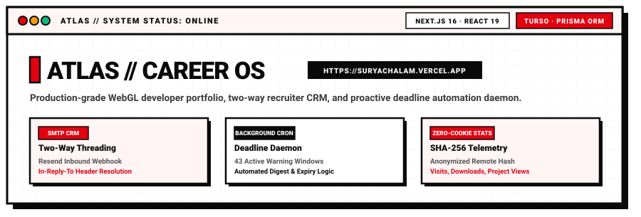
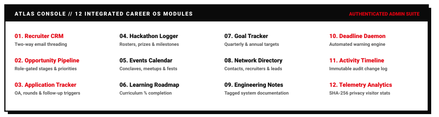
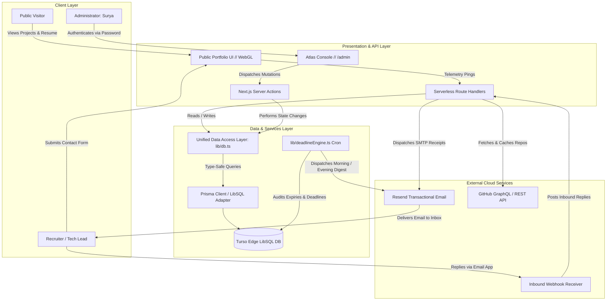
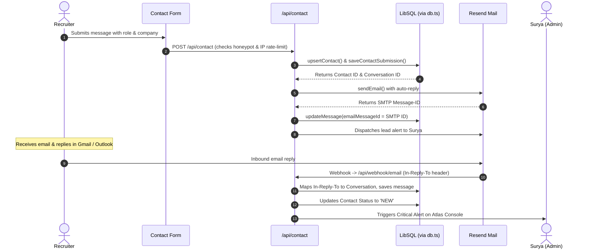
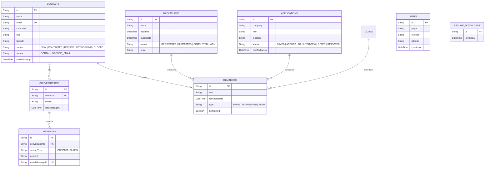
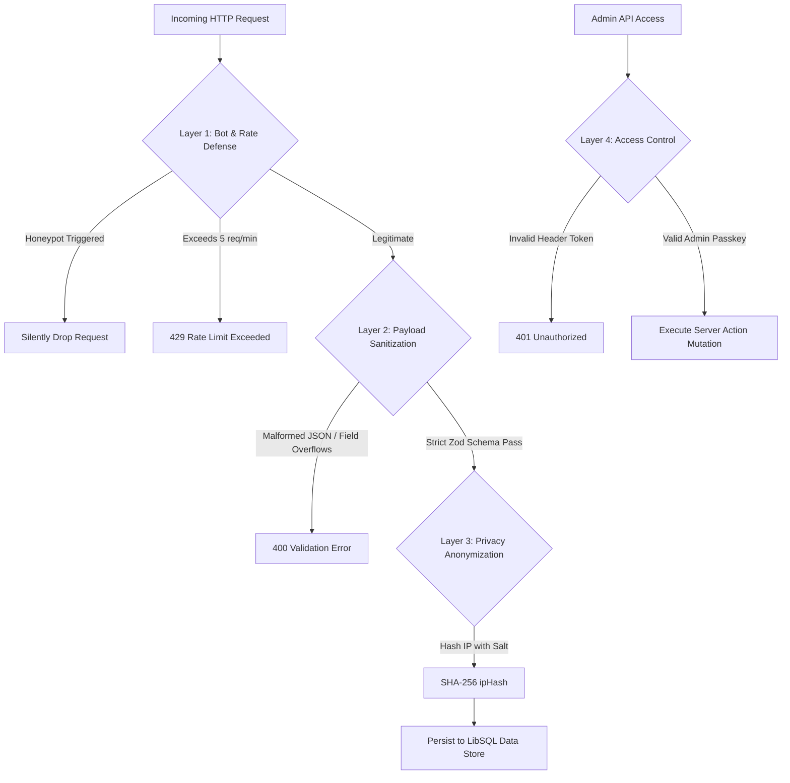

<p align="center">
  
</p>

<p align="center">
  <a href="https://suryachalam.vercel.app"></a>
  <a href="https://nextjs.org/"></a>
  <a href="https://react.dev/"></a>
  <a href="https://prisma.io/"></a>
  <a href="https://resend.com/"></a>
</p>

---

## Executive Overview

**Atlas** is a production-grade personal portfolio and full-stack career management operating system designed for software engineers. Beyond a standard static developer site, Atlas pairs a high-contrast **Neo-Brutalist WebGL portfolio** with a secured **12-module telemetry dashboard (Atlas Console)**, an integrated **two-way email CRM** with automated inbound threading, and a background **proactive deadline intelligence daemon**.

### Key System Metrics
* **Production Status:** Live at [suryachalam.vercel.app](https://suryachalam.vercel.app)
* **Architecture:** Next.js 16 (App Router), React 19, Server Actions, Edge Route Handlers
* **Database:** SQLite (local development) / Turso LibSQL (edge-replicated production) via Prisma ORM
* **Modules:** 12 unified career management workflows in a protected administrator console
* **Telemetry:** 0-cookie, privacy-preserving SHA-256 IP hashing for visits, downloads, and project clicks
* **Email Infrastructure:** Resend transactional mail with SMTP `In-Reply-To` header resolution and local IST timezone scheduling

---

<p align="center">
  
</p>

---

## Why Atlas Stands Out

| Engineering Dimension | Production Implementation |
| :--- | :--- |
| **Product & Lead Funnel** | Converts passive portfolio visitors and recruiters into an active lead funnel with automated acknowledgment receipts and two-way CRM tracking. |
| **Two-Way Threading** | Resolves inbound replies to recruiter emails via Resend webhooks using SMTP `In-Reply-To` message identifiers, linking conversations seamlessly. |
| **Proactive Intelligence** | Background scheduler audits 43 warning windows across applications and hackathons, automatically firing reminders and status transitions. |
| **Privacy-First Analytics** | Captures real-time visitor telemetry without invasive tracking cookies by hashing remote IPs with SHA-256 and salt. |
| **Bespoke Visual Craft** | Kinetic Neo-Brutalist UI equipped with 38 custom 2D pixel art skill badges generated with Python and Aseprite. |
| **Enterprise Data Layer** | Relational schema with 17 Prisma models powered by `@prisma/adapter-libsql` for instant zero-downtime edge failover. |

---

## System Integration Topology



---

## Core Engineering Capabilities

### 1. Recruiter CRM & Two-Way Threading Engine
When a visitor or recruiter reaches out through the contact form, Atlas treats it as a first-class CRM lead:
1. **Validation & Spam Defense:** The payload passes client-side validation, a hidden bot honeypot (`hp_field`), an in-memory IP rate limiter, and a strict Zod schema.
2. **Outbound Receipt & Metadata Tagging:** Atlas generates a contact record, assigns a message UUID, and sends an automated confirmation via Resend while capturing the outbound SMTP `Message-ID`.
3. **Inbound Reply Resolution:** When the recruiter replies in their email client, Resend forwards the webhook payload to `/api/webhook/email`. Atlas extracts the `In-Reply-To` header, pairs it with the existing thread, updates the contact status to `NEW`, and triggers a critical dashboard alert.



---

### 2. Proactive Deadline Intelligence Daemon
The deadline engine ([`lib/deadlineEngine.ts`](file:///c:/projects/SGK18_Portfolio/lib/deadlineEngine.ts)) operates as an autonomous background daemon:
* **Warning Windows:** Continuously evaluates upcoming deadlines across Applications, Hackathons, Goals, and Follow-ups across 43 active warning windows.
* **Auto-Expiry Transitions:** Automatically flips stale deadlines to `EXPIRED` or `ARCHIVED`, recording an immutable event in `activity_logs`.
* **Timezone-Aligned Digests:** Computes UTC+05:30 (IST) relative offsets to deliver morning briefings (8:00 AM IST) and evening summaries (8:00 PM IST) directly to Surya's inbox.

---

### 3. Zero-Cookie Telemetry Analytics
Atlas respects visitor privacy while gathering high-fidelity engagement insights:
* **SHA-256 IP Hashing:** Remote IP addresses are extracted on the server, salted, and hashed using SHA-256. Raw IP addresses are never saved to disk.
* **Granular Telemetry:** Captures unique daily visits, total page impressions, resume downloads (`/public/resume.pdf`), and clicks on specific project case studies.

---

## Database Architecture (Prisma & Turso LibSQL)

The relational schema is defined in [`prisma/schema.prisma`](file:///c:/projects/SGK18_Portfolio/prisma/schema.prisma) across 17 models:



---

## Tech Stack & 38 Equipped 2D Pixel Sprites

Every technology badge on the live site is accompanied by a bespoke 20x20 retro pixel sprite generated via Python and Aseprite:

### Languages
| Sprite | Skill | Category | Notes |
| :---: | :--- | :--- | :--- |
|  | **TypeScript** | Language | Strict typings across App Router & DAL |
|  | **JavaScript** | Language | ESNext standards, Node.js scripts |
|  | **Python** | Language | Sprite generation scripts & automation |
|  | **Java** | Language | Object-oriented systems & DSA |
|  | **Dart** | Language | Flutter mobile client architectures |
|  | **SQL** | Language | Relational schemas, indexing, joins |
|  | **PL/SQL** | Language | Stored procedures & triggers |
|  | **C++** | Language | Systems programming, algorithms |

### Frontend & Mobile
| Sprite | Skill | Category | Notes |
| :---: | :--- | :--- | :--- |
|  | **React 19** | Frontend | Server Components, Concurrent Mode |
|  | **Next.js 16** | Frontend | App Router, Turbopack, Server Actions |
|  | **Flutter** | Mobile | Riverpod state, cross-platform apps |
|  | **Capacitor** | Mobile | Native Android plugins, camera, sensors |
|  | **Tailwind CSS** | Styling | v4 CSS variables, Neo-brutalist theme |
|  | **Framer Motion** | Animation | Scroll-triggered entry sequences & reveals |
|  | **PWA** | Mobile | Offline web apps, web manifest |
|  | **Service Workers** | Mobile | Background caching, push event listeners |

### Backend, Databases & Infra
| Sprite | Skill | Category | Notes |
| :---: | :--- | :--- | :--- |
|  | **Node.js** | Backend | Serverless runtimes & background daemons |
|  | **Express 5** | Backend | REST microservices & middleware routing |
|  | **PostgreSQL** | Database | Relational production storage |
|  | **Supabase** | Backend | Auth, Row-Level Security (RLS), real-time |
|  | **Prisma** | ORM | Type-safe schema migrations & LibSQL client |
|  | **Neo4j** | Graph DB | Graph algorithms, node/edge modeling |
|  | **Valkey** | Caching | Redis-compatible distributed cache layer |
|  | **MySQL HeatWave** | Database | Analytics & OLAP query acceleration |
|  | **Docker** | DevOps | Containerized local and deployment images |

### Cloud, Integrations & Tools
| Sprite | Skill | Category | Notes |
| :---: | :--- | :--- | :--- |
|  | **AWS** | Cloud | Cloud architecture, S3, IAM |
|  | **OCI** | Cloud | Oracle Cloud Infrastructure services |
|  | **CI/CD** | DevOps | Automated linting, test suites, deployments |
|  | **Resend** | Email | Transactional emails & inbound webhook parsing |
|  | **JWT / JOSE** | Security | Edge Middleware stateless tokens & claims |
|  | **FCM** | Push | Firebase Cloud Messaging push channels |
|  | **OneSignal** | Push | Cross-platform web & mobile notifications |
|  | **Git & GitHub** | Tools | Structured version control workflows |
|  | **Vercel** | Hosting | Edge caching, analytics, serverless functions |
|  | **Figma** | Design | UI/UX design systems & wireframing |

---

## Security Audit & Hardening

Atlas implements four concentric rings of defensive design:



1. **Honeypot Trap:** Forms include hidden honeypot fields (`hp_field`). Automated scrapers and spam bots populate this input, causing the server to silently discard the payload without database writes.
2. **IP Sliding-Window Rate Limiting:** Form submissions and analytics pings are rate-limited per IP hash to prevent flooding attacks.
3. **Zod Schema Sanitization:** Strict input schemas enforce maximum lengths (e.g., 5,000 characters for messages, validated RFC-compliant emails) to block SQL or script injection attempts.
4. **Header-Authenticated Admin Sessions:** The Atlas Console requires passkey validation via encrypted Server Actions, preventing unauthorized access to telemetry or candidate data.

---

## Developer Runbook & Local Setup

### Prerequisites
* **Node.js:** `v20.x` or higher
* **npm:** `v10.x` or higher
* **Python:** `v3.10+` (optional, for regenerating retro pixel sprites)
* **pdfLaTeX:** MiKTeX or TeX Live (optional, for compiling `resume.tex`)

### 1. Clone & Install
```bash
git clone https://github.com/sgk18/SGK18_Portfolio.git
cd SGK18_Portfolio
npm install
```

### 2. Configure Environment Variables
Create a `.env.local` file in the root directory:
```env
ADMIN_PASSWORD=your_secure_console_password
RESEND_API_KEY=re_your_resend_api_token
RESEND_FROM_EMAIL=Atlas <onboarding@resend.dev>
RESEND_INBOUND_EMAIL=your_email@gmail.com
CRON_SECRET=your_background_scheduler_cron_key
WEBHOOK_SECRET=your_resend_inbound_webhook_token
```

### 3. Initialize Database
```bash
npx prisma generate
npx prisma db push
```

### 4. Run Development Server
```bash
npm run dev
```
Open [http://localhost:3000](http://localhost:3000) for the public portfolio.  
Access the authenticated control suite at [http://localhost:3000/admin](http://localhost:3000/admin).

### 5. Build for Production
```bash
npm run build
```

---

## Repository Map

```
SGK18_Portfolio/
├── app/                        # Next.js 16 App Router Core
│   ├── actions/                # Server Actions (Atlas mutations & CRM triggers)
│   ├── admin/                  # Protected Atlas Console UI & CRM workspace
│   ├── api/                    # Serverless APIs (telemetry, contact, cron, webhook)
│   ├── globals.css             # Tailwind v4 theme tokens & Neo-brutalist styles
│   └── page.tsx                # Public Portfolio Home
├── assets/                     # Project branding & README visual system
│   └── readme/                 # Hero SVG, module diagrams, architecture banners
├── components/                 # Reusable UI component modules
│   ├── layout/                 # Navbar, Footer, StaggeredMenu, PillNav
│   ├── sections/               # Hero, About, Skills, Experience, Projects, etc.
│   └── ui/                     # CaseStudyModal, ScrollReveal, RetroBadges
├── lib/                        # Architecture & DAL Utilities
│   ├── db.ts                   # Centralized Data Access Layer
│   ├── deadlineEngine.ts       # Proactive deadline background scheduler
│   └── prisma.ts               # Prisma singleton with LibSQL adapter
├── prisma/                     # Relational Database Model
│   └── schema.prisma           # 17 entity definitions & indexes
├── public/                     # Static production assets
│   ├── resume.pdf              # Compiled 1-page ATS LaTeX resume
│   └── sprites/skills/         # 38 bespoke PNG & Aseprite skill badges
├── resume/                     # Resume LaTeX Source
│   └── resume.tex              # Jake's Resume ATS source
└── scripts/                    # Automation utilities
    └── build_skill_sprites.py  # Python + Aseprite 2D pixel sprite generator
```

---

## Author & Connect

* **Engineer:** Suryachalam V M
* **Portfolio:** [suryachalam.vercel.app](https://suryachalam.vercel.app)
* **GitHub:** [@sgk18](https://github.com/sgk18)
* **LinkedIn:** [linkedin.com/in/suryachalam](https://linkedin.com/in/suryachalam)
* **Email:** [suryachalam18@gmail.com](mailto:suryachalam18@gmail.com)

---

<p align="center">
  <b>Atlas // SGK18 Portfolio</b> · Engineered with Next.js 16, React 19, Prisma &amp; LibSQL · Licensed under MIT
</p>
